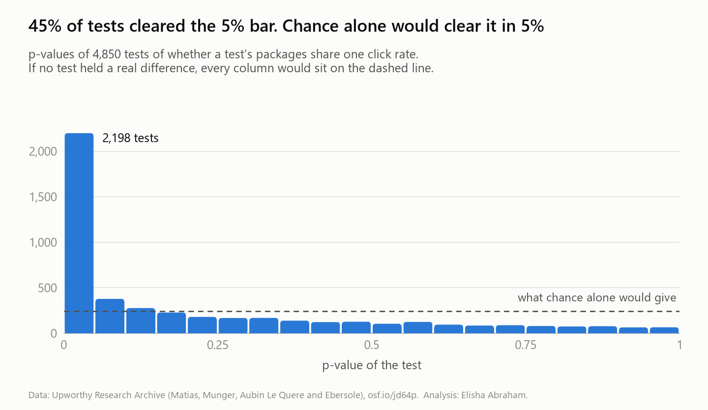
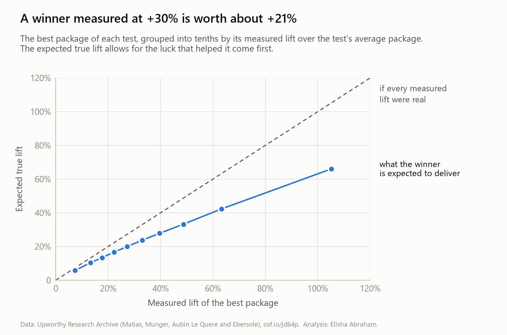
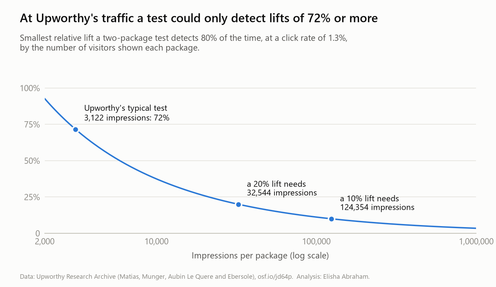
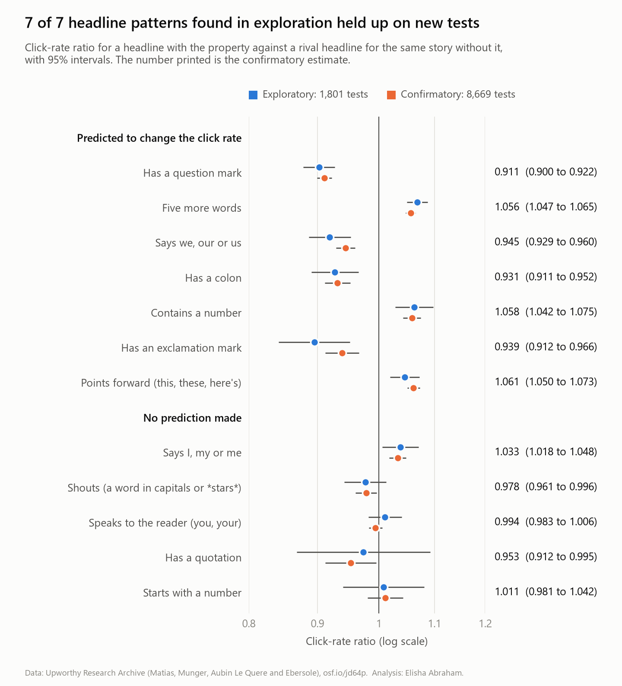

# What 27,000 headline experiments say about A/B testing

**When a team runs A/B tests by the thousand, how often is there a real winner, how much of a win is luck, and what can be learned across tests that no single test can show?**

An analysis in Python of 27,614 experiments run by the news site Upworthy between 2013 and 2015, done the way a careful experimenter works: explore one part of the data, write the predictions down, then test them once on the rest.

`Python` · `pandas` · `A/B testing` · `false discovery rate` · `power analysis` · `shrinkage of winners` · `fixed-effects Poisson regression` · `pre-planned confirmation`

## The short answer

For each story Upworthy wrote several "packages" (a headline with an image and teaser text), showed each visitor one at random, and counted clicks. A typical package was shown about 3,100 times and clicked about 40 times.

1. **Most tests found something real, and a third found nothing.** 45.6% of tests were significant at the 5% level and 36.5% still counted with the false discovery rate held at 5%. About 65% are estimated to hold a real difference, so in about a third there was nothing to find.
2. **One test in six did not run as designed.** In 15.5% of tests the traffic was split too unevenly between packages to be chance. Chance would produce that in 0.1%.
3. **Winners are flattered.** The best package in a test beat its test's average by 30%. With no real differences at all, the "best" package would still appear to win by 16%. Allowing for that luck, the winner's real advantage is about 22%.
4. **The tests could only see big effects.** At Upworthy's traffic, a two-package test detects a lift reliably only if it is 72% or more. Detecting a 10% lift needs 124,000 impressions per package, forty times what a typical package got.
5. **Thousands of tests together show what no single test can.** Comparing headlines only with rivals for the same story: five more words bring 6% more clicks, a number 6% more, and pointing forward ("this", "these", "here's") 6% more. A question mark costs 9%, a colon 7%, an exclamation mark 6%, and saying "we", "our" or "us" 6%.
6. **Every prediction held.** All twelve figures predicted from the exploratory tests replicated on the confirmatory tests, and all seven headline hypotheses were confirmed.

## What a team that runs tests should take from this

| Finding | Practice |
|---|---|
| 15.5% of tests had an uneven traffic split. | Check the split before reading a result. A test that did not randomise as designed has not earned trust. |
| Typical traffic could only detect a 72% lift. | Decide the traffic before the test, from the smallest lift worth acting on. Hunting a 10% lift with this traffic is running blind. |
| The winner's measured 30% lift is worth about 22%. | Discount the winner. Forecast with roughly three-quarters of a measured win, and less for a surprisingly large one. |
| At the 5% level, 45.6% of tests pass; about 65% hold a real difference. | When reviewing many tests, control the false discovery rate, and expect real effects among the tests that "failed". |
| Seven wording patterns held on 8,669 fresh tests. | Pool tests to learn rules, and confirm the rules on tests that were kept aside. |

## Findings in detail

### How often the packages really differ

<picture>
  <source media="(prefers-color-scheme: dark)" srcset="figures/01_p_values_dark.png">
  
</picture>

Each test was given a chi-square test of whether all its packages share one click rate. If no test held a real difference, the p-values would be spread evenly and every column would sit on the dashed line. The tall first column is the real differences; the columns on the right, which sit *below* the line, show how few tests have nothing in them.

What was varied matters. Tests that changed only the headline were significant 54.3% of the time, tests that changed only the image 44.4%, and tests that changed only the teaser text 22.8%.

### How much of a win is luck

<picture>
  <source media="(prefers-color-scheme: dark)" srcset="figures/02_winners_curse_dark.png">
  
</picture>

The best package was chosen because it scored highest, and part of every score is luck. Click rates inside a test vary more than sampling noise explains: packages for the same story truly differ by a standard deviation of about 25%. Comparing that real spread with the noise in each package's count gives the share of a measured advantage that is real, about 77% for a typical winner. The bigger the measured win, the more of it is luck.

### What the traffic could detect

<picture>
  <source media="(prefers-color-scheme: dark)" srcset="figures/03_detectable_lift_dark.png">
  
</picture>

| Lift to detect | Impressions needed per package | Times Upworthy's typical traffic |
|---|---|---|
| 50% | 5,902 | 1.9 |
| 30% | 15,110 | 4.8 |
| 20% | 32,544 | 10.4 |
| 10% | 124,354 | 39.8 |
| 5% | 485,745 | 155.6 |

These tests were built to find big differences, and big differences were there to find. The same design would be useless for the small improvements most product teams look for.

### What winning headlines have in common

<picture>
  <source media="(prefers-color-scheme: dark)" srcset="figures/04_headline_patterns_dark.png">
  
</picture>

Only tests in which the headline is the one thing that differs are used (1,801 exploratory, 8,669 confirmatory), and headlines are compared only with rivals in the same test. The story, the image, the day and the audience are therefore identical for the headlines being compared.

Twelve properties were tried on the exploratory tests. The seven whose effect was at least three standard errors from zero became hypotheses, each with a direction. On the confirmatory tests all seven were significant after Holm's correction and in the predicted direction.

The plan also predicted that the seven effects, having been picked for their size, would be smaller on new data. Six of the seven were, and their average size fell from 8.1% to 6.7%. That is the winner's curse again, this time applied to my own findings.

## How the work was done

| Step | File | What it does |
|---|---|---|
| 1 | [`src/abtests.py`](src/abtests.py) | The statistics, written out in numpy and pandas: per-test chi-square tests, the traffic-split check, Benjamini-Hochberg and Holm corrections, Storey's estimate of true nulls, the spread of true effects, shrinkage of winners, power, and the within-test headline model. |
| 2 | [`01_exploratory.ipynb`](01_exploratory.ipynb) | Everything above on the exploratory tests, and the choice of hypotheses. |
| 3 | [`analysis_plan.md`](analysis_plan.md) | The predictions and decision rules, committed before the confirmatory file was used. |
| 4 | [`02_confirmatory.ipynb`](02_confirmatory.ipynb) | One run on the confirmatory tests. |

The notebooks are generated from `01_exploratory.py` and `02_confirmatory.py`, which are the source of truth.

**The headline model.** A test's clicks are divided among its packages in proportion to impressions x exp(x·β). This is Poisson regression with a separate baseline for every test; the baselines cancel, so the model needs no parameter per test and runs on tens of thousands of tests. Standard errors are clustered by test, and they are 2.3 times the model's own: without clustering every effect would look far more certain than it is.

### How I know the numbers are right

- **Predictions were fixed first.** The commit history shows `analysis_plan.md` committed before the confirmatory notebook was run. All 12 whole-archive predictions landed inside their allowed range, none further than 1.4 points from the predicted figure.
- **The model was checked against a standard library.** On a 300-test subset, the from-scratch model gives the same coefficients as statsmodels' Poisson regression with a dummy variable per test (largest difference 3e-14).
- **Charts cannot drift from the data.** Their titles take their numbers from the results.

## Limits of this analysis

- **A property of a headline is not assigned at random.** Visitors were randomised to headlines, but editors wrote the headlines. A headline with a question mark differs from its rivals in other ways too, so each effect is the effect of the kind of headline that has the property.
- **One site, one period.** Upworthy's audience and style in 2013 to 2015 are not every site's. The method transfers; the wording rules may not.
- **Clicks are not value.** Nothing here measures whether readers were glad they clicked.
- **Tests with an uneven split were kept.** Leaving them out changes little (in the exploratory tests 44.7% of evenly split tests are significant, against 48.9% of the others), but the reason for the unevenness is not known.
- **The shrinkage is a model.** It assumes true differences between packages are normally distributed with the same spread in every test. It sizes the winner's curse; it should not be used to rescore single tests.
- **The chi-square test asks whether any package differs**, not whether the winner is better than the runner-up.

## Run it yourself

Requirements: Python 3.10 or later.

```bash
pip install -r requirements.txt
python scripts/01_download_data.py      # two files from OSF, 81 MB
python scripts/build_notebooks.py       # runs both notebooks, about four minutes
```

## Repository layout

```
src/          statistics and chart helpers
scripts/      download the data; build and run the notebooks
results/      CSV tables written by the notebooks
figures/      charts, in light and dark variants
data/         data notes; data/raw/ is filled by the download script
```

## Data and licence

Data: Matias, J. N., Munger, K., Aubin Le Quere, M. S. A., & Ebersole, C. R. *The Upworthy Research Archive*. OSF. https://osf.io/jd64p. The data files are not redistributed here.

Code in this repository: MIT licence.

## Author

**Elisha Abraham** is a healthcare and research data analyst with clinical training in nursing.
[LinkedIn](https://www.linkedin.com/in/elisha-abraham-a90569352) · [GitHub](https://github.com/elisha-abraham) · elishaabraham25@gmail.com
